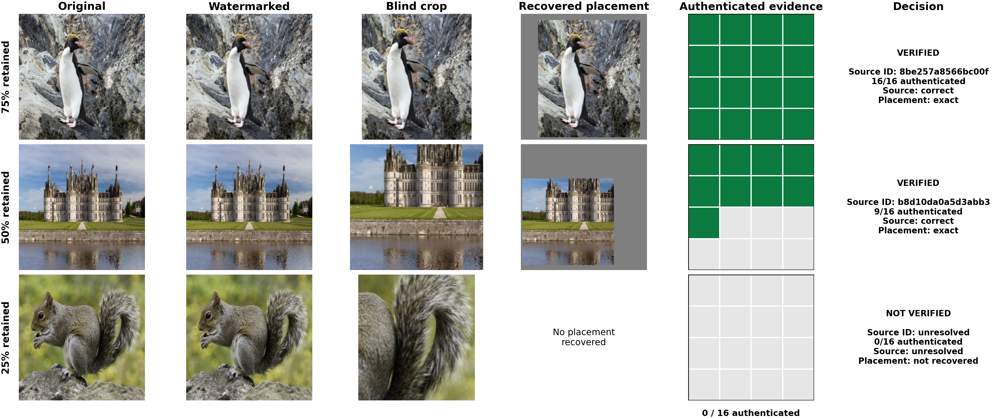

# K-FRAG V4.15 -- spatially indexed fragment watermarking

Public code and research artifacts for reconstructing a keyed source token from partial 256 x 256 watermarked images using 16 indexed 64 x 64 regions, a 20-bit packet per region, and two RS(16,6) codewords. The source token and authentication tag are **separate** six-byte HMAC-derived values, encoded into complementary regional evidence. This is **source-token provenance verification**, not per-region authenticity or pixel-level tamper localization.

**Read first:** [Reproducibility and scope](docs/REPRODUCIBILITY.md) and [historical results provenance](docs/RESULTS_PROVENANCE.md). The reported performance numbers below are **historical**, not regenerated by the public tests or this documentation update. The public `verify_crop_v415` pipeline is **not shown equivalent** to the frozen notebook phase-search pipeline.

## Quick installation

Requires Python 3.12 and PyTorch/torchvision matched to your platform; for the original GPU environment, see `environment/environment.json` and `environment/requirements_frozen.txt`. For an environment with compatible PyTorch already installed:

```bash
python -m pip install -r requirements.txt
```

The recorded environment uses Python 3.12.13, PyTorch 2.10.0+cu128, CUDA 12.8 and NVIDIA Tesla T4. These are historical environment values, not a guarantee they are available on every machine.

## Test the release

```bash
python tests/test_release_contract.py
python tests/test_public_runtime.py
python tests/test_public_roundtrip.py
# The following tests are slow; CUDA recommended:
python tests/test_public_crop_recovery.py
python tests/test_public_retained_areas.py
```

The first check is static and checks checkpoint SHA-256 values and configuration. Remaining tests use deterministic synthetic carriers. The public crop test uses a 192 x 192 square crop = **56.25% retained area**; the retained-area test uses a set of centered square crops, not the paper's exact crop manifest. Passing these tests does not reproduce 800 DIV2K trials.

## Public APIs

```python
from kfrag_runtime.runtime_loader import load_v415_runtime
from kfrag_runtime.embedding import embed_full_spatial_image_v4
from kfrag_runtime.verify import verify_crop_v415
from kfrag_runtime.protocol_v4 import V4_AUTH_DOMAIN

runtime = load_v415_runtime('checkpoints/KFRAG_V415_FINAL_MODELS.pt')
# image_tensor: floating point RGB tensor of shape [1,3,256,256]
# Use a fresh secret generated through an appropriate key-management system.
# Test example only (NOT a deployment key):
auth_key = bytes(range(32))
watermarked = embed_full_spatial_image_v4(
    clean_image=image_tensor,
    source_id=b'public-test-source',
    runtime=runtime,
    auth_key=auth_key,
)['watermarked']
result = verify_crop_v415(
    crop=watermarked[0], runtime=runtime,
    auth_key=auth_key, auth_domain=V4_AUTH_DOMAIN, top_k=20,
)
print(result['accepted'], result['status'])
```

## Historical results reported in the manuscript

The main blind-crop evaluation used 100 DIV2K validation images, eight nominal retained-area conditions and 800 trials:

| Nominal retained area | 25% | 30% | 40% | 50% | 60% | 75% | 80% | 95% |
|---|---:|---:|---:|---:|---:|---:|---:|---:|
| Correct source verification / 100 | 83 | 99 | 100 | 100 | 100 | 100 | 100 | 100 |

The manuscript reports no incorrect-source acceptance across those 800 trials. At 40% area, 100 source tokens were verified but 82 crop origins were exact. The reported 25%-area mean runtime was 47.538 s, compared with 0.519 s at 95%. Historical fidelity on 100 DIV2K images at 256 x 256 is PSNR 39.00 dB, SSIM 0.9650, LPIPS 0.002609. Under known alignment, JPEG Q95 yielded 98% and JPEG Q90 37% source verification. **All are reported results, not independently rerun by this code release.**

Matched crop geometry (as reported by the manuscript) but **different success criteria**:

| Area | K-FRAG keyed source | WAM exact 32-bit | InvisMark exact 100-bit |
|---|---:|---:|---:|
| 25% | 83% | 94% | 0% |
| 30% | 99% | 97% | 0% |
| 40% | 100% | 98% | 22% |
| 50% | 100% | 96% | 72% |
| 60% | 100% | 99% | 85% |
| 75% | 100% | 94% | 94% |
| 80% | 100% | 97% | 94% |
| 95% | 100% | 91% | 96% |

The matched-crop baseline evaluation records and regenerated K-FRAG crop manifest are available in [`results/matched_crop_baselines/`](results/matched_crop_baselines/). The accompanying audit script verifies all 800 crop configurations per baseline and recomputes exact-message recovery rates from the recorded CSVs. These records do not independently reproduce the historical K-FRAG verification results.

Earlier release documentation is preserved in [`docs/README_PREVIOUS_RELEASE.md`](docs/README_PREVIOUS_RELEASE.md). The COCO rescue-assisted results follow a separate experimental protocol and must not be confused with the main no-rescue V4.15 evaluation.

## Image illustration



Green/highlighted cells represent **reconstruction-support positions**, not independently authenticated regions. A verified source need not have an exact recovered crop origin. The illustrative visual does not replace per-trial benchmark evidence.

## Release contents

- `checkpoints/` -- three original pretrained model files (not altered).
- `kfrag_runtime/` -- original neural and blind-search runtime (not altered).
- `config/` -- original historical frozen configuration (not altered).
- `tests/` -- original synthetic scripts and a new static release-contract check.
- `results/` -- **reported historical aggregates**, never represented as newly executed outputs.
- `docs/` -- architecture and scope, evidence inventory, and supplementary code instructions.
- `splits/` -- COCO subset identifier lists; not independent evidence of training isolation from earlier development.

## Security and anonymous submission

Generate your own 32-byte key. The historical private authentication key is absent; `bytes(range(32))` is public. PyTorch's checkpoint loading must only be used with trusted weights; see [SECURITY.md](SECURITY.md).

The public repository includes identifying citation information; **do not link to it from a double-blind CVPR submission**. Use a checked anonymous supplementary-code ZIP uploaded through the conference submission system. CVPR 2027 disallows external links that expand the contribution. See `docs/SUPPLEMENTARY_CODE_README.md`.

License: Apache-2.0; bibliographic attribution in `CITATION.cff` applies to the public repository only.
